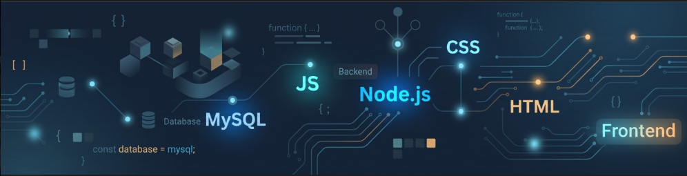

<h1 align="center">Hi there, I'm Filipe Matos Silva! 👋</h1>

  <b>Systems Analysis & Development (ADS) Student @ FATEC Indaiatuba | Web & Embedded IoT</b>

  🔗 <a href="https://www.linkedin.com/in/filipe-m-silva-522836253" target="_blank"><b>LinkedIn Profile</b></a> &nbsp;•&nbsp;
  📫 <a href="mailto:YOUR_EMAIL_HERE@gmail.com"><b>Send me an Email</b></a> &nbsp;•&nbsp;
  💻 <a href="https://github.com/Sil3lipe" target="_blank"><b>GitHub (@Sil3lipe)</b></a>

---

### ⚡ `// SYSTEM_NODE: ABOUT_ME`

<pre><code class="language-javascript">const profile = {
  name: "Filipe Matos Silva",
  education: "Systems Analysis & Development (ADS) @ FATEC (2nd Sem)",
  languages: ["Portuguese (Native)", "English (Advanced - US Exchange)"],
  foundation: ["Hardware & Software QA @ Lenovo", "IT Hardware Maintenance"],
  currentFocus: "Bridging Web Development, Embedded IoT & Process Optimization",
  status: "Open to IT / Software Engineering Internships"
};</code></pre>

I am a 2nd-semester **Systems Analysis and Development (ADS)** student at FATEC Indaiatuba, driven by logic, technology, and continuous learning. My journey blends **international experience in the US** (providing me with advanced English proficiency) with a hands-on foundation in **hardware and software QA testing from my time at Lenovo** and IT hardware maintenance. 

Currently working in stock operations, I actively use my day-to-day environment as a real-world lab—observing administrative workflows, identifying logistical bottlenecks, and mapping business requirements to build practical software and IoT solutions.

🎯 **Current Goal:** Seeking an **IT / Software Development Internship** where I can apply my coding, testing, and hardware-integration skills to solve real-world engineering problems.

---

### 🎛️ `// CIRCUIT_BOARD: TECH_STACK`

  

 

| Node | Technologies & Tools |
| :--- | :--- |
| **💻 Languages & Web** | `C` • `JavaScript (ES6+)` • `TypeScript` • `HTML5` • `CSS3` |
| **📡 Embedded Hardware & IoT** | `Arduino` • `ESP32` • `Bluetooth Low Energy (BLE)` |
| **🛡️ Quality, Testing & Tools** | `Hardware/Software QA` • `Vitest` • `SonarQube` • `Git & GitHub` • `VS Code` |
| **🌱 Next on my Roadmap** | `Node.js` • `SQL (MySQL)` • `Full-Stack Integration` |

---

### 🚀 `// DEPLOYED_MODULES: FEATURED_PROJECTS`

| Module | Stack | Architecture & Engineering Focus |
| :--- | :--- | :--- |
| 📡 **[findit-rastreamento-esp32-ble](https://github.com/Sil3lipe/findit-rastreamento-esp32-ble)** | `C` `ESP32` `BLE` | Low-level proximity tracking system using Bluetooth Low Energy signal strength (RSSI) for real-time hardware localization. |
| 🧮 **[Calculadora-Web](https://github.com/Sil3lipe/Calculadora-Web)** | `JavaScript` `HTML5` `CSS3` | Interactive web application emphasizing clean DOM manipulation, state transitions, and edge-case input validation. |

> 🔧 **`[R&D_PROTOTYPE]`:** Engineering an **automated inventory management & IoT piece-counting system** designed to solve real-world stock separation bottlenecks, alongside my personal developer portfolio.

---

### 💠 `// CORE_ADVANTAGES: WHAT_I_BRING`

- **QA & Diagnostic Mindset:** Background inspecting notebook assembly lines at **Lenovo** and performing IT troubleshooting—bringing strong attention to detail from physical hardware up to application code.
- **Business-to-Tech Translation:** Practical habit of analyzing physical/logistical bottlenecks and translating them into structured software requirements.
- **Global Communication:** Advanced English fluency honed through living and working in the United States.

---

<b>🇧🇷 [ ACESSAR VERSÃO EM PORTUGUÊS // CLIQUE PARA EXPANDIR ]</b>

 

### 👨‍💻 Sobre Mim

Sou estudante do 2º semestre de **Análise e Desenvolvimento de Sistemas (ADS)** na FATEC Indaiatuba, movido pela lógica, tecnologia e aprendizado contínuo.

Minha trajetória une **vivência internacional nos EUA** (inglês avançado) com uma base prática em **testes de qualidade de hardware e software (QA) adquirida na Lenovo** e manutenção de TI. Atualmente atuando na área operacional de estoque, utilizo meu ambiente diário como laboratório prático: observando processos administrativos, identificando gargalos logísticos e mapeando requisitos de negócios para criar soluções reais de software e IoT.

🎯 **Objetivo Atual:** Busco ativamente um **Estágio em TI / Desenvolvimento de Software** onde eu possa contribuir com soluções tecnológicas reais e evoluir junto à equipe.

### 🛠️ Tecnologias & Ferramentas

- **Linguagens & Web:** `C`, `JavaScript`, `TypeScript`, `HTML5`, `CSS3`
- **Sistemas Embarcados & IoT:** `Arduino`, `ESP32`, `Bluetooth Low Energy (BLE)`
- **Qualidade & Ferramentas:** `QA de Hardware/Software`, `Vitest`, `SonarQube`, `Git/GitHub`, `VS Code`
- **Próximos Passos (Estudando):** `Node.js`, `SQL (MySQL)`

### 🚀 Projetos em Destaque & Pesquisa Atual

- 📡 **[findit-rastreamento-esp32-ble](https://github.com/Sil3lipe/findit-rastreamento-esp32-ble)** (`C` / `ESP32` / `BLE`): Sistema de rastreamento por proximidade via Bluetooth Low Energy.
- 🧮 **[Calculadora-Web](https://github.com/Sil3lipe/Calculadora-Web)** (`JavaScript` / `HTML/CSS`): Aplicação web interativa focada em manipulação de DOM e lógica.
- 🔧 **Em Desenvolvimento:** Protótipo de **sistema automatizado de estoque e contagem de peças via IoT** aplicado à logística real.

### 💼 Diferenciais

- **Mentalidade de Qualidade (QA):** Experiência prática em testes de hardware e software na **Lenovo**, aliada a boas práticas de testes e análise de código.
- **Visão de Processos e Negócios:** Facilidade para identificar problemas operacionais no mundo real e traduzi-los em requisitos técnicos.
- **Inglês Avançado:** Fluência desenvolvida através de intercâmbio nos Estados Unidos.

