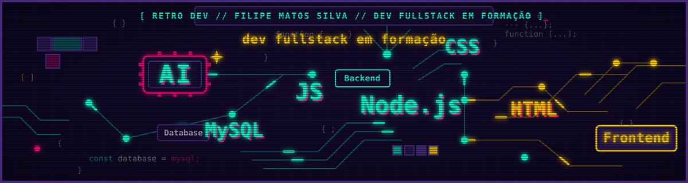
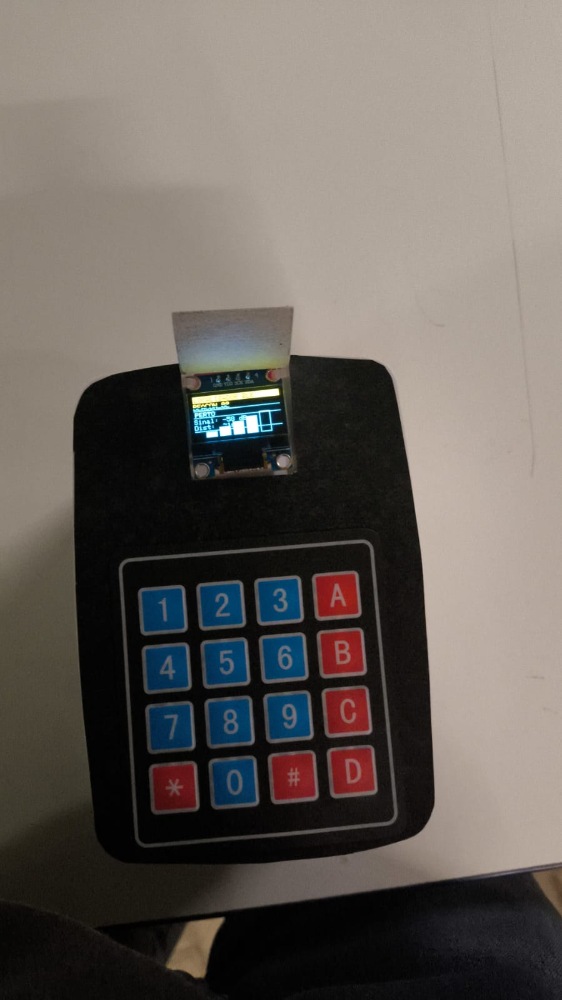
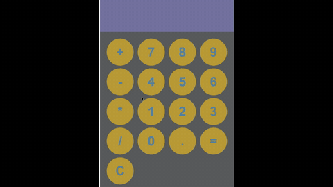

# Filipe Matos Silva `// player_one`

 

---

## 🎮 Sobre mim `// player_profile`

<table>
  <tr>
    <td width="52%" valign="middle">
      
Sou estudante de <b>Análise e Desenvolvimento de Sistemas</b> na FATEC Indaiatuba, movido por lógica, tecnologia e aprendizado contínuo. Minha trajetória une <b>vivência internacional nos EUA</b> (inglês avançado) com uma base prática em <b>testes de qualidade de hardware e software (QA) na Lenovo</b> e manutenção de TI.

      
Hoje atuo na área operacional de estoque e uso esse ambiente como laboratório: observo processos, identifico gargalos logísticos e transformo esses problemas em requisitos para criar soluções reais de software e IoT.

    </td>
    <td width="48%" valign="middle">
<pre lang="js"><code>const playerOne = {
  name: "Filipe M. Silva",
  origin: "RJ -> Indaiatuba, SP",
  education: "ADS @ FATEC Indaiatuba",
  skills: [
    "Inglês avançado (vivência EUA)",
    "QA de Hardware e Software"
  ],
  focus: "Web Dev & IoT Embarcado",
  lookingFor: "Estágio em TI / Dev"
};</code></pre>
    </td>
  </tr>
</table>

---

## 🎒 Stack `// inventory`

  

 

<table align="center">
  <tr>
    <th>Área</th>
    <th>Tecnologias & Ferramentas</th>
  </tr>
  <tr>
    <td><b>💻 Linguagens e Web</b></td>
    <td>
      
      
      
      
      
      
    </td>
  </tr>
  <tr>
    <td><b>🔌 Embarcados e IoT</b></td>
    <td>
      
      
      
    </td>
  </tr>
  <tr>
    <td><b>🛡️ Qualidade e DevTools</b></td>
    <td>
      
      
      
      
      
    </td>
  </tr>
  <tr>
    <td><b>📚 Estudando agora</b></td>
    <td>
      
      
      
    </td>
  </tr>
</table>

---

## 🗺️ Projetos `// mission_log`

<table>
  <tr>
    <td width="50%" valign="top">
      <h3 align="center">📡 FINDIT — Rastreamento BLE</h3>
      

        
        
        
        
      

  

      
<b>Problema:</b> Em estoques dinâmicos, a disposição física muda com frequência e dificulta achar setores e itens.

      
<b>Solução:</b> Beacons BLE em ESP32 + scanner com display OLED e teclado 4x4 que indica a proximidade pelo sinal (RSSI) com ~10m de alcance indoor, sem depender de Wi-Fi.

      
<b>Minha parte (Projeto Integrador):</b> Desenvolvimento do firmware em C++ com o grupo (leitura RSSI, display OLED, teclado 4x4 e comunicação entre placas).

      

        
      

    </td>
    <td width="50%" valign="top">
      <h3 align="center">💸 Controle de Gastos</h3>
      

        
        
      

      
<b>Solução:</b> Aplicação individual em TypeScript que registra despesas e gera relatórios estruturados por categoria.

      
<b>Qualidade:</b> Validação das regras de negócio e cálculos garantida por suíte de testes automatizados com Vitest.

         
      

        
      

    </td>
  </tr>
  <tr>
    <td width="50%" valign="top">
      <h3 align="center">🧮 Calculadora Web</h3>
      

        
        
        
      

  

      
<b>Solução:</b> Aplicação web interativa construída para praticar manipulação limpa do DOM, controle de transições de estado e prevenção de entradas inválidas.

      

        
      

    </td>
    <td width="50%" valign="top">
      <h3 align="center">🔧 Side Quest // Em Andamento</h3>
      

        
        
      

      
<b>Protótipo de Controle e Contagem de Peças:</b> Projeto de IoT desenhado para atacar gargalos reais de separação e conferência em operações de estoque.

      

        
      

    </td>
  </tr>
</table>

---

## ⚡ O que eu levo para o time `// special_buffs`

* <kbd>🛡️ Mentalidade de QA</kbd> — Experiência prática inspecionando linhas de montagem de notebooks e resolvendo problemas de TI, com atenção a detalhes que vão do hardware até o código.
* <kbd>⚙️ Do Processo ao Código</kbd> — Hábito de analisar gargalos físicos e logísticos no dia a dia e traduzi-los em requisitos claros de software.
* <kbd>🌎 Comunicação Global</kbd> — Inglês avançado, desenvolvido vivendo e trabalhando nos Estados Unidos.

---

## 🌐 English Version `// player_two`

<b>🇺🇸 Click here to expand the full interactive profile in English</b>

 

<h3>Filipe Matos Silva <code>// player_two</code></h3>

 

---

### 🎮 About me `// player_profile`

<table>
  <tr>
    <td width="52%" valign="middle">
      
I'm a <b>Systems Analysis and Development (ADS)</b> student at FATEC Indaiatuba, driven by logic, technology, and continuous learning. My background combines <b>international experience in the US</b> (advanced English) with hands-on <b>hardware and software QA testing at Lenovo</b> and IT hardware maintenance.

      
I currently work in stock operations and treat it as a real-world lab: I observe workflows, spot logistical bottlenecks, and turn them into requirements for practical software and IoT solutions.

    </td>
    <td width="48%" valign="middle">
<pre lang="js"><code>const playerTwo = {
  name: "Filipe M. Silva",
  origin: "RJ -> Indaiatuba, SP (Brazil)",
  education: "ADS @ FATEC Indaiatuba",
  skills: [
    "Advanced English (US experience)",
    "Hardware && Software QA"
  ],
  focus: "Web Dev && Embedded IoT",
  lookingFor: "IT / Software Dev Internship"
};</code></pre>
    </td>
  </tr>
</table>

---

### 🎒 Stack `// inventory`

  

 

<table align="center">
  <tr>
    <th>Area</th>
    <th>Technologies && Tools</th>
  </tr>
  <tr>
    <td><b>💻 Languages && Web</b></td>
    <td>
      
      
      
      
      
      
    </td>
  </tr>
  <tr>
    <td><b>🔌 Embedded && IoT</b></td>
    <td>
      
      
      
    </td>
  </tr>
  <tr>
    <td><b>🛡️ Quality && DevTools</b></td>
    <td>
      
      
      
      
      
    </td>
  </tr>
  <tr>
    <td><b>📚 Currently Learning</b></td>
    <td>
      
      
      
    </td>
  </tr>
</table>

---

### 🗺️ Projects `// mission_log`

<table>
  <tr>
    <td width="50%" valign="top">
      <h3 align="center">📡 FINDIT — BLE Proximity Tracking</h3>
      

        
        
        
        
      

  

      
<b>Problem:</b> Items and sections are hard to locate in dynamic warehouses whose physical layout changes frequently.

      
<b>Solution:</b> ESP32 BLE beacons + a scanner with an OLED display and 4x4 keypad that indicates proximity via signal strength (RSSI) with ~10m indoor range and no Wi-Fi required.

      
<b>My role (Capstone Project):</b> C++ firmware development alongside the team (RSSI reading, OLED display output, 4x4 keypad input, and board-to-board communication).

      

        
      

    </td>
    <td width="50%" valign="top">
      <h3 align="center">💸 Expenses Control</h3>
      

        
        
      

      
<b>Solution:</b> Individual TypeScript application that tracks expenses and generates structured per-category reports.

      
<b>Quality:</b> Business logic and calculations validated through an automated unit testing suite built with Vitest.

         
      

        
      

    </td>
  </tr>
  <tr>
    <td width="50%" valign="top">
      <h3 align="center">🧮 Web Calculator</h3>
      

        
        
        
      

  

      
<b>Solution:</b> Interactive web calculator focused on clean DOM manipulation, state transitions, and invalid-input prevention.

      

        
      

    </td>
    <td width="50%" valign="top">
      <h3 align="center">🔧 Side Quest // In Progress</h3>
      

        
        
      

      
<b>IoT Inventory & Parts-Counting Prototype:</b> IoT solution designed to tackle real-world stock-separation and verification bottlenecks.

      

        
      

    </td>
  </tr>
</table>

---

### ⚡ What I bring `// special_buffs`

* <kbd>🛡️ QA Mindset</kbd> — Hands-on experience inspecting notebook assembly lines and troubleshooting IT, with attention to detail from hardware up to application code.
* <kbd>⚙️ Process-to-Code Translation</kbd> — A habit of analyzing physical and logistical bottlenecks and turning them into clear software requirements.
* <kbd>🌎 Global Communication</kbd> — Advanced English, built by living and working in the United States.

  

  <a href="#filipe-matos-silva--player_one">⬆ Back to the top</a>

