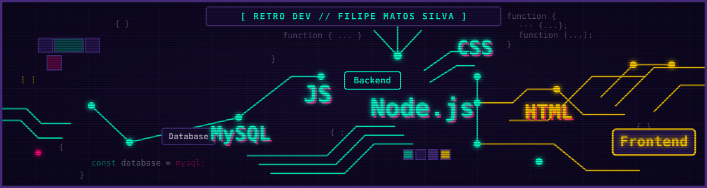

<div align="center">



# Filipe Matos Silva `// player_one`

**Estudante de ADS na Fatec Indaiatuba** · Web (JS/TS) e sistemas embarcados (ESP32) · **Buscando estágio em TI / Desenvolvimento de Software**

[**[ ▶ LinkedIn ]**](https://www.linkedin.com/in/filipe-m-silva-522836253) · [**[ ▶ E-mail ]**](mailto:TROCAR-PELO-SEU-EMAIL) · [**[ ▶ GitHub ]**](https://github.com/Sil3lipe)

</div>

---

## Sobre mim `// player_profile`

```js
const playerOne = {
  name: "Filipe M. Silva",
  origin: "RJ -> Indaiatuba, SP",
  education: "Análise e Desenvolvimento de Sistemas (ADS) @ FATEC",
  skills: ["Inglês avançado (vivência nos EUA)", "QA de Hardware e Software"],
  focus: "Desenvolvimento Web e IoT Embarcado",
  lookingFor: "Estágio em TI / Desenvolvimento de Software"
};
```

> Sou estudante de **Análise e Desenvolvimento de Sistemas** na FATEC Indaiatuba, movido por lógica, tecnologia e aprendizado contínuo. Minha trajetória une **vivência internacional nos EUA** (inglês avançado) com uma base prática em **testes de qualidade de hardware e software (QA) na Lenovo** e manutenção de TI.
>
> Hoje atuo na área operacional de estoque e uso esse ambiente como laboratório: observo processos, identifico gargalos logísticos e transformo esses problemas em requisitos para criar soluções reais de software e IoT.

---

## Stack `// inventory`


| Área | Tecnologias |
|:--|:--|
| **Linguagens e web** | `C` · `C++` · `JavaScript (ES6+)` · `TypeScript` · `HTML5` · `CSS3` |
| **Embarcados e IoT** | `Arduino` · `ESP32` · `Bluetooth Low Energy (BLE)` |
| **Qualidade e ferramentas** | `QA de Hardware/Software` · `Vitest` · `SonarQube` · `Git & GitHub` · `VS Code` |
| **Estudando agora** | `Node.js` · `SQL (MySQL)` · `Python` |

---

## Projetos `// mission_log`

### 📡 [FINDIT — Rastreamento por proximidade com ESP32 e BLE](https://github.com/Sil3lipe/findit-rastreamento-esp32-ble)
`C/C++` `Arduino` `ESP32` `BLE`

- **Problema:** em estoques dinâmicos, a disposição física muda com frequência e dificulta achar setores e itens.
- **Solução:** beacons BLE em ESP32 e um scanner com display OLED e teclado 4x4 que indica a proximidade pela intensidade do sinal (RSSI), sem depender de Wi-Fi ou internet.
- **Resultado:** protótipo funcional, com alcance útil de cerca de 10 m em ambiente interno. Os limites do método (RSSI indica proximidade, não posição exata) estão documentados no repositório.
- **Projeto em grupo (Projeto Integrador, ADS).** Minha parte: TROCAR-PELA-SUA-PARTE-NO-FINDIT.

### 💸 [Controle de Gastos](https://github.com/Sil3lipe/controle-gastos)
`TypeScript` `Vitest`

- **Solução:** projeto individual em TypeScript que registra gastos e gera relatório por categoria.
- **Qualidade:** testes automatizados com Vitest.

### 🧮 [Calculadora Web](https://github.com/Sil3lipe/Calculadora-Web)
`JavaScript` `HTML5` `CSS3`

- **Solução:** aplicação web interativa com foco em manipulação limpa do DOM, transições de estado e validação de entradas inválidas.

---

## Em andamento `// side_quest`

🔧 **Protótipo de controle de estoque e contagem de peças com IoT**, em fase de planejamento, para atacar gargalos reais de separação de estoque.

---

## O que eu levo para o time `// special_buffs`

- **Mentalidade de QA:** experiência inspecionando linhas de montagem de notebooks e resolvendo problemas de TI, com atenção a detalhes do hardware até o código.
- **Do processo ao código:** hábito de analisar gargalos físicos e logísticos e traduzi-los em requisitos de software.
- **Comunicação global:** inglês avançado, praticado vivendo e trabalhando nos Estados Unidos.

---

<details>
<summary><b>🇺🇸 Read in English</b></summary>

<br>

**Filipe Matos Silva** · Systems Analysis & Development (ADS) student at FATEC Indaiatuba · Web (JS/TS) and embedded systems (ESP32) · **Open to IT / Software Development internships**

### About me `// player_profile`

I'm a **Systems Analysis and Development** student at FATEC Indaiatuba, driven by logic, technology and continuous learning. My background combines **international experience in the US** (advanced English) with hands-on **hardware and software QA testing at Lenovo** and IT hardware maintenance.

I currently work in stock operations and treat it as a real-world lab: I observe workflows, spot logistical bottlenecks and turn them into requirements for practical software and IoT solutions.

### Stack `// inventory`

| Area | Technologies |
|:--|:--|
| **Languages & web** | `C` · `C++` · `JavaScript (ES6+)` · `TypeScript` · `HTML5` · `CSS3` |
| **Embedded & IoT** | `Arduino` · `ESP32` · `Bluetooth Low Energy (BLE)` |
| **Quality & tools** | `Hardware/Software QA` · `Vitest` · `SonarQube` · `Git & GitHub` · `VS Code` |
| **Currently learning** | `Node.js` · `SQL (MySQL)` · `Python` |

### Projects `// mission_log`

**📡 [FINDIT — Proximity tracking with ESP32 and BLE](https://github.com/Sil3lipe/findit-rastreamento-esp32-ble)** (`C/C++` `Arduino` `ESP32` `BLE`)
Team project (university capstone). Problem: items and sections are hard to locate in warehouses whose layout changes often. Solution: BLE beacons on ESP32 plus a scanner with OLED display and 4x4 keypad that indicates proximity from signal strength (RSSI), with no Wi-Fi or internet required. Result: working prototype with roughly 10 m of useful indoor range; the limits of RSSI-based estimation are documented in the repo. My part: TROCAR-PELA-SUA-PARTE-NO-FINDIT-EM-INGLES.

**💸 [Controle de Gastos](https://github.com/Sil3lipe/controle-gastos)** (`TypeScript` `Vitest`)
Individual expense tracker in TypeScript with per-category reports and automated tests in Vitest.

**🧮 [Calculadora Web](https://github.com/Sil3lipe/Calculadora-Web)** (`JavaScript` `HTML5` `CSS3`)
Interactive web calculator focused on clean DOM manipulation, state transitions and invalid-input handling.

### Side quest `// in_progress`

🔧 **IoT-based inventory and parts-counting prototype**, in planning, aimed at real stock-separation bottlenecks.

### What I bring `// special_buffs`

- **QA mindset:** experience inspecting notebook assembly lines and troubleshooting IT, with attention to detail from hardware up to application code.
- **Process-to-code translation:** a habit of analyzing logistical bottlenecks and turning them into software requirements.
- **Global communication:** advanced English, built by living and working in the United States.

</details>
